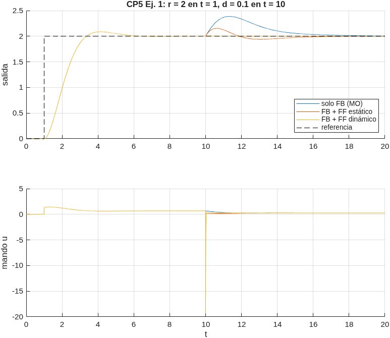
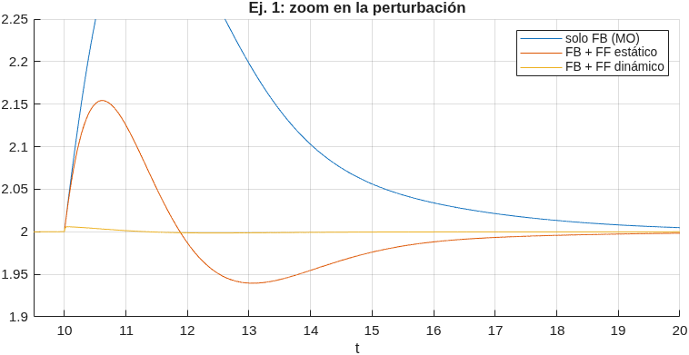
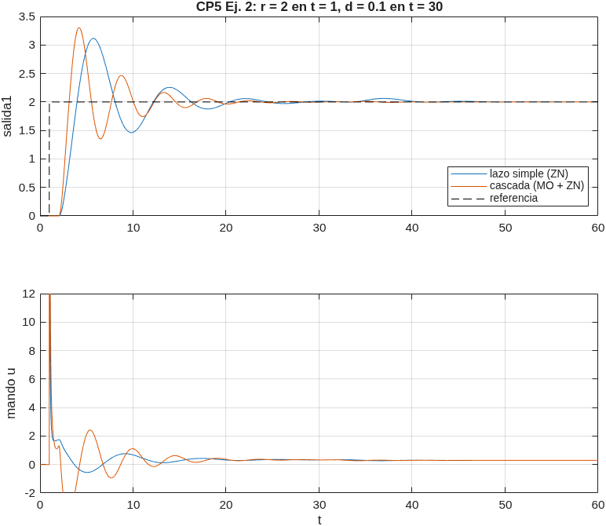
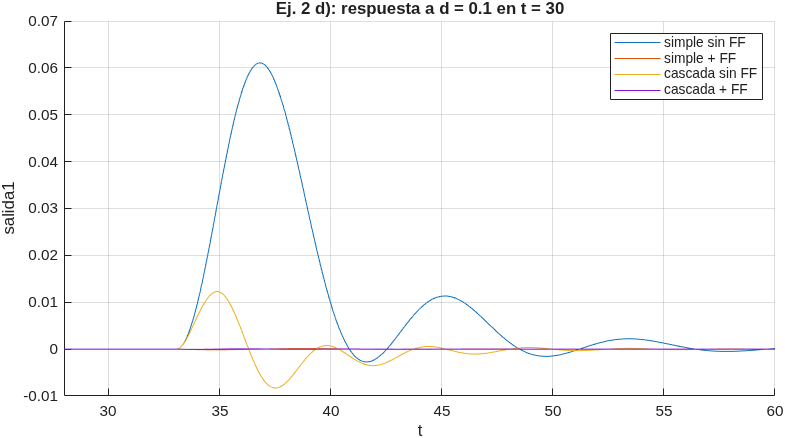

# CP-5: Control feedforward, resuelto paso a paso

**Archivos de esta carpeta**

| Archivo | Qué es |
|---|---|
| `cp5.m` | Script MATLAB con todos los cálculos y simulaciones. Genera `ej1.png`, `ej1_zoom.png`, `ej2_bc.png` y `ej2_d.png`. |
| `cp5_ej1.slx`, `cp5_ej2_simple.slx`, `cp5_ej2_cascada.slx` | **Modelos Simulink** de cada esquema. El bloque `FF_on` (1/0) activa o desactiva el feedforward. |
| `cp5_simulink.m` | Construye los `.slx` por código, los simula, verifica que coincidan con `cp5.m` y exporta los diagramas (`diag_*.png`). |

**Diagramas Simulink:** imágenes, tabla de bloques y parámetros en [`Diagramas_Simulink_CP5-CP6.md`](../Diagramas_Simulink_CP5-CP6.md).

**Cómo se simula en `cp5.m`:** todos los bloques son lineales, así que el diagrama Simulink equivale a armar el lazo con `connect` (bloques con `InputName`/`OutputName` y `sumblk`) y simularlo con `lsim`. Para que los retardos no hagan lenta la simulación se discretiza con `c2d(...,'zoh')` (exacto para entradas escalón). Los modelos Simulink dan los mismos resultados.

**Fórmulas que se usan** (ver [`Resumen_Conf4-6.md`](../Resumen_Conf4-6.md), secciones 6–8):

$$G_{ff}(s)=-\frac{G_d(s)}{G_m(s)\,G_p(s)}\qquad\qquad Y=\frac{G_{fb}G_p}{1+G_{fb}G_pG_{m1}}\,Y_{sp}+\frac{G_d+G_{m2}G_{ff}G_p}{1+G_{fb}G_pG_{m1}}\,D$$

En ambos ejercicios no se dan sensores, así que $G_m=1$.

---

# Ejercicio 1

$$\text{mando}\to G_v\to(+)\to G_p\to\text{salida},\qquad \text{perturbación}\to K_d\to(+)$$

$$G_v=\frac{2}{s+2}=\frac{1}{0.5s+1},\qquad G_p=\frac{6}{4s+2}=\frac{3}{2s+1},\qquad K_d=4$$

La perturbación entra **entre la válvula y el proceso**, así que llega a la salida a través de $G_p$: su FT hasta la salida es $K_dG_p$.

## a) Controlador por módulo óptimo

1. Planta que ve el controlador: $G=G_vG_p=\dfrac{3}{(0.5s+1)(2s+1)}$.
2. $T_u=0.5$ (la menor constante; no se compensa). Se compensa $T=2$.
3. MO con $K_r=1$:

$$G_c=\frac{1}{2T_us(T_us+1)\,G}=\frac{(0.5s+1)(2s+1)}{2(0.5)s(0.5s+1)\cdot3}=\frac{2s+1}{3s}$$

$$\boxed{G_c=0.6667+\frac{0.3333}{s}\qquad(\textbf{PI}:\ K_p=0.667,\ T_i=2)}$$

Lazo cerrado ante la referencia: $\dfrac{1}{2T_u^2s^2+2T_us+1}=\dfrac{1}{0.5s^2+s+1}$ ($\zeta=0.707$, $M_p\approx4\%$).

## b) Simulación: $r=2$ en $t=1$, $d=0.1$ en $t=10$ (20 unidades)

Curva azul de `ej1.png`. Sigue la referencia con ≈ 4 % de sobrepaso. La perturbación de 0.1 (×4 = 0.4 a la entrada de $G_p$) desvía la salida hasta **+0.387** y el PI la corrige lentamente: por la cancelación del polo $(2s+1)$, ante la perturbación reaparece la constante de tiempo lenta de 2.

## c) Controlador feedforward

$$G_{ff}=-\frac{G_d}{G_mG_vG_p}=-\frac{K_dG_p}{G_vG_p}=-\frac{K_d}{G_v}=-4\,(0.5s+1)=\boxed{-2s-4}$$

- Se cancela todo $G_p$ (la perturbación y el mando pasan por el mismo proceso). Solo queda **invertir la válvula**.
- Es **impropia** (un cero y ningún polo): hay que derivar la perturbación. Se implementan dos versiones:
  - **Estática:** $G_{ff}=-4$ (compensa solo el estado estable).
  - **Dinámica realizable:** $G_{ff}=-4\dfrac{0.5s+1}{0.01s+1}$ (se agrega un polo 50 veces más rápido).

## d) Esquema FB + FF

La acción de control es $u=u_{fb}+u_{ff}$, con $u_{ff}=G_{ff}\,d$.





| Esquema | Pico de la salida ante $d=0.1$ |
|---|---|
| Solo FB (MO) | +0.387 |
| FB + FF estático | +0.154 (y luego −0.06) |
| FB + FF dinámico | **+0.006** |

## e) Comentarios

- El FF **no cambia la respuesta a la referencia** (las tres curvas coinciden hasta $t=10$): no está dentro del lazo y no altera la ecuación característica.
- El **FF estático** reduce el pico a menos de la mitad, pero no lo anula: la perturbación llega a $G_p$ **instantáneamente**, mientras que la corrección pasa por la válvula ($\tau=0.5$) y llega tarde. Por eso hay un pico positivo y después un pequeño "rebote" negativo que corrige el FB.
- El **FF dinámico** adelanta la acción con el cero $(0.5s+1)$, compensa el retardo de la válvula y la perturbación prácticamente **desaparece** de la salida. El costo es un pico grande y breve en el mando ($u\approx-12$ en $t=10$, gráfico inferior): en una planta real habría que verificar que el actuador no se sature.
- El FB sigue siendo necesario: corrige los errores de modelo y las perturbaciones que no se miden.

---

# Ejercicio 2

$$\text{mando}\to G_v\to(+)\to G_1\to\text{salida2}\to G_2\to e^{-s}\to\text{salida1}$$

$$G_v=\frac{2}{s+4}=\frac{0.5}{0.25s+1},\quad G_1=\frac{4}{4s+2}=\frac{2}{2s+1},\quad G_2=\frac{6}{4s+1},\quad L_p=1$$

$$\text{Perturbación: }G_d\,e^{-2s}=\frac{2}{s+10}\,e^{-2s}=\frac{0.2}{0.1s+1}\,e^{-2s}\ \text{(entra a la entrada de }G_1\text{)}$$

## a) PID por Ziegler-Nichols para salida1

```matlab
Ga = Gv*G1*G2;  Ga.OutputDelay = 1;
[Ku,~,wu] = margin(Ga);  Tu = 2*pi/wu;
```

Fase con el retardo: $-\arctan(0.25\omega)-\arctan(2\omega)-\arctan(4\omega)-\omega=-\pi\Rightarrow\omega_u=0.739$ rad/s.

$$K_u=\mathbf{0.943}\qquad T_u=\frac{2\pi}{0.739}=\mathbf{8.51}$$

PID serie (ZN): $K'_c=K_u/1.6=0.590$, $T'_i=T_u/2=4.253$, $T'_d=T_u/8=1.063$. Pasado a **ideal**:

$$\boxed{K_c=0.737\qquad T_i=5.316\qquad T_d=0.851}$$

(Implementado con filtro derivativo $N=10$: `pidstd(Kc,Ti,Td,10)`.)

## b) Simulación: $r=2$ en $t=1$, $d=0.1$ en $t=30$ (60 unidades)

Curva azul de `ej2_bc.png`: $M_p=55.8\%$, $t_s(2\%)=22.2$, pico ante la perturbación **+0.062**. El sobrepaso grande es típico de ZN (criterio ¼ RD) con un retardo apreciable.

## c) Cascada: salida2 (lazo interno) y salida1 (lazo externo)

**Lazo interno (salida2) por MO.** La planta interna $G_vG_1=\dfrac{1}{(0.25s+1)(2s+1)}$ (ganancia 0.5·2 = 1) **no tiene retardo**: su fase nunca llega a −180°, así que **no tiene $K_u$** y ZN no sirve. Se usa MO con $T_u=0.25$:

$$G_{c,in}=\frac{(0.25s+1)(2s+1)}{2(0.25)s(0.25s+1)}=\frac{2s+1}{0.5s}=\boxed{4+\frac{2}{s}}\qquad\Rightarrow\qquad G_{LC,in}=\frac{1}{0.125s^2+0.5s+1}$$

La perturbación entra **dentro** de este lazo (antes de $G_1$), así que la corrige el lazo interno.

**Lazo externo (salida1) por ZN** sobre $G_{LC,in}\cdot G_2\cdot e^{-s}$ (lazo interno exacto):

$$K_u=0.808,\quad T_u=5.38\ \Rightarrow\ \text{serie: }0.505,\ 2.690,\ 0.672\ \Rightarrow\ \boxed{K_c=0.631\quad T_i=3.362\quad T_d=0.538}$$

$T_u$ bajó de 8.5 a 5.4: el lazo interno "acelera" la planta que ve el externo.

Lazo simple (`cp5_ej2_simple.slx`):


Cascada (`cp5_ej2_cascada.slx`):




| Estrategia | $M_p$ | $t_s$ (2 %) | Pico ante $d$ |
|---|---|---|---|
| Lazo simple (ZN) | 55.8 % | 22.2 | +0.0616 |
| Cascada (MO + ZN) | 65.1 % | 17.5 | **+0.0121** |

- Ante la **perturbación** la cascada es **5 veces mejor**: el lazo interno la ve en salida2 y la corrige antes de que pase por $G_2$ y el retardo.
- Ante la **referencia** ambas oscilan mucho (es la sintonía ZN). La cascada responde antes pero con más sobrepaso. Si se quiere menos sobrepaso, se puede bajar $K_c$ del externo o usar una sintonía integral (ITAE).

## d) Feedforward

$$G_{ff}=-\frac{G_d\,e^{-2s}}{G_m\,G_v}=-\frac{\frac{2}{s+10}e^{-2s}}{\frac{2}{s+4}}=\boxed{-\frac{s+4}{s+10}\,e^{-2s}}$$

- La perturbación y el mando se encuentran **antes de $G_1$**, así que $G_1$, $G_2$ y $e^{-s}$ se cancelan.
- Es **propia** (un cero y un polo: un adelanto-atraso) y el retardo es **positivo** (la perturbación tarda 2 en llegar; la válvula no tiene retardo): es **totalmente realizable**, no hace falta aproximar nada.
- Ganancia estática $-0.4$: $\dfrac{0.2}{0.5}=0.4$ es la relación de ganancias perturbación/válvula.
- En los dos esquemas se suma a la salida del controlador que mueve la válvula ($u=u_{fb}+u_{ff}$). En la cascada, esa es la salida del controlador **interno**.

Experimento: solo la perturbación ($d=0.1$ en $t=30$, referencia en 0).



| Estrategia | Pico de salida1 | IAE |
|---|---|---|
| Lazo simple sin FF | +0.0611 | 0.301 |
| Lazo simple + FF | −0.0001 | 0.0008 |
| Cascada sin FF | +0.0123 | 0.049 |
| Cascada + FF | +0.0001 | 0.0003 |

**Conclusión:** con un modelo exacto, el FF **anula** la perturbación en ambos casos (lo que queda es error numérico). Sin FF, la cascada ya reduce el efecto unas 5 veces respecto del lazo simple. En la práctica (modelo imperfecto) lo mejor es combinar ambos: el FF quita casi todo el efecto de la perturbación medida y la cascada corrige rápido lo que quede.
