# CP-6: Predictor de Smith y estrategias afines, resuelto paso a paso

**Archivos de esta carpeta**

| Archivo | Qué es |
|---|---|
| `cp6.m` | Script MATLAB con todos los cálculos y simulaciones de los 5 ejercicios. Genera `ej1_*.png`, `ej2.png`, `ej3.png`, `ej4.png`, `ej5*.png`. |
| `cp6_simulink.m` | Construye por código los modelos **Simulink** de los ej. 3 y 5 (`cp6_ej3.slx`, `cp6_ej5.slx`), los simula y genera `ej3_simulink.png` y `ej5_simulink.png`. |
| `cp6_ej3.slx`, `cp6_ej5.slx` | Los modelos Simulink (se abren y modifican a mano). |

Los lazos se arman con `connect` + `lsim` (discretizado con `c2d(...,'zoh')`, exacto para escalones). Los modelos Simulink dan los mismos resultados (ej. 3: $M_p=3.61\%$ en ambos).
Teoría: [`Resumen_Conf4-6.md`](../Resumen_Conf4-6.md), secciones 9–11.

---

# Ejercicio 1: calentador PORT con predictor de Smith

$$G(s)=\frac{5\,e^{-0.8s}}{s+1}\quad[\text{°C/V, min}],\qquad u\in[0,\,10]\ \text{V}$$

## a) PI por Ziegler-Nichols

$$-\omega_u\cdot0.8-\arctan(\omega_u)=-\pi\ \Rightarrow\ \omega_u=2.448\ \text{rad/min},\qquad K_u=\frac{\sqrt{1+\omega_u^2}}{5}=\mathbf{0.529},\qquad T_u=\mathbf{2.567}\ \text{min}$$

$$\boxed{K_c=\frac{K_u}{2.2}=0.240\qquad T_i=\frac{T_u}{1.2}=2.139\ \text{min}}$$

**Respuesta** (`ej1_ab.png`, curva azul; $r=2$ °C en $t=1$): $M_p=5.9\%$, pero **lenta**: $t_s(2\%)=8.7$ min, unas 11 veces el retardo.

**Conclusión sobre $L/T$:** $L/T=0.8$ está **fuera** del rango de validez de ZN ($0.1\le L/T\le0.5$). El retardo domina la dinámica: para no perder estabilidad, ZN entrega una ganancia muy baja ($K_cK=1.2$) y un lazo lento. Es justo el caso que motiva el predictor de Smith.

## b) PI por cancelación + predictor de Smith

Con Smith, el controlador "ve" la planta **sin retardo** $P=\dfrac{5}{s+1}$. PI por cancelación ($T_i=T=1$):

$$G_cP=K_p\frac{s+1}{s}\cdot\frac{5}{s+1}=\frac{5K_p}{s}\ \Rightarrow\ \frac{Y}{R}=\frac{5K_p}{s+5K_p}\,e^{-0.8s}$$

**Elección de $K_p$:** en $t=0^+$ el error es todo el escalón y el integrador todavía no aporta: $u(0^+)=K_p\,\Delta r$. Para no saturar con el máximo cambio (2 °C):

$$K_p\cdot2\le10\ \Rightarrow\ \boxed{K_p=5,\quad T_i=1\ \text{min}}\qquad T_{LC}=\frac{T}{K_pK}=\frac{1}{25}=0.04\ \text{min}$$

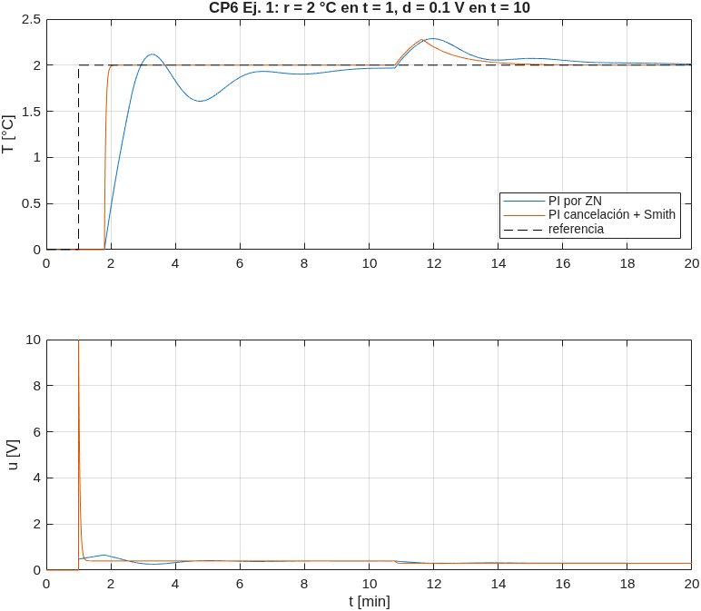

Con Smith la temperatura llega a 2 °C justo después del retardo, **sin sobrepaso**, y se asienta en 0.96 min (0.8 de retardo + 0.16), contra 8.7 min con ZN. El mando arranca exactamente en 10 V (el límite) y baja a 0.4 V.

**Robustez: cada parámetro de la planta ±10 %, uno a la vez** (el predictor mantiene el modelo nominal):

| Parámetro de la planta | $K_p=5$ (pedido) | $K_p=1$ ($T_{LC}=0.2$ min) |
|---|---|---|
| $K$ −10 % / +10 % | 0 % / 10 % de sobrepaso | 0 % / 8 % |
| $T$ −10 % / +10 % | 8.7 % / 3.4 % | 3.8 % / 2.7 % |
| $L$ −10 % / +10 % | **inestable** (oscilación creciente) | 1.5 % / 14 % |

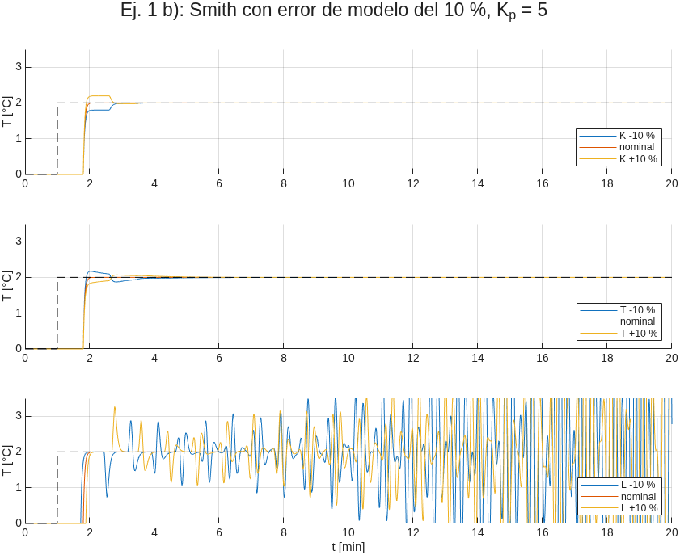
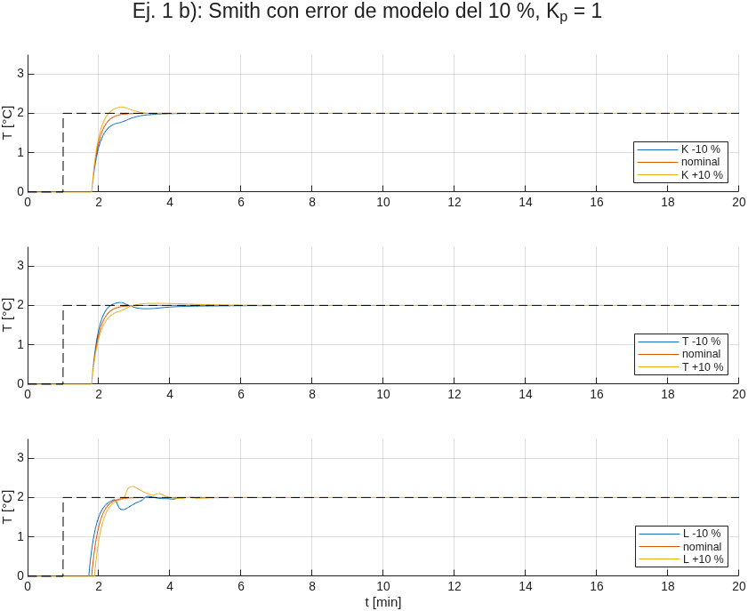

**Conclusiones:**
- Un error en $K$ o en $T$ apenas deforma la respuesta, y el integrador sigue dando error cero.
- Un error del 10 % en el **retardo** **desestabiliza** el lazo con $K_p=5$: eso confirma lo visto en clase (los errores en $L$ son mucho peores que en $T$).
- El problema es que $K_p=5$ pide un lazo 20 veces más rápido que el retardo. El predictor "promete" una planta sin retardo, pero la diferencia entre el retardo real y el modelado se ve como una perturbación de alta frecuencia que ese lazo tan rápido amplifica.
- Con un lazo menos agresivo ($K_p=1$, $T_{LC}=L/4$) el sistema tolera los tres errores. Además, con `margin` se verificó que $K_p\le3$ es estable para **todas** las combinaciones simultáneas de ±10 % en $K$, $T$ y $L$. **Recomendación:** no usar el $K_p$ máximo que permite la saturación, sino uno con margen frente a errores en el retardo.

## c) Extra: predictor de Smith filtrado

En el Smith clásico, la respuesta a una perturbación en la entrada sigue teniendo el **polo lento de la planta** ($s=-1$):

$$\frac{Y}{D}=P\,e^{-Ls}\left[1-\frac{G_cP}{1+G_cP}\,e^{-Ls}F_r(s)\right]$$

(con $F_r=1$ en el Smith clásico). La idea del Smith filtrado es pasar el error de predicción $(y-\hat y)$ por un filtro $F_r(s)$, con $F_r(0)=1$ para no perder el error cero, elegido para que el corchete se anule en $s=-1/T$ y así **cancelar el polo lento**:

$$F_r(-1)=\frac{1+G_cP}{G_cP\,e^{-Ls}}\bigg|_{s=-1}=\frac{1-25}{-25\,e^{0.8}}=0.96\,e^{-0.8}=0.4314$$

Filtro de primer orden (adelanto-atraso) $F_r=\dfrac{\beta s+1}{T_fs+1}$ con $T_f=L/2=0.4$:

$$\frac{1-\beta}{1-0.4}=0.4314\ \Rightarrow\ \beta=0.741\qquad\boxed{F_r(s)=\frac{0.741s+1}{0.4s+1}}$$

La referencia **no cambia** ($Y/R$ no depende de $F_r$ con el modelo exacto).

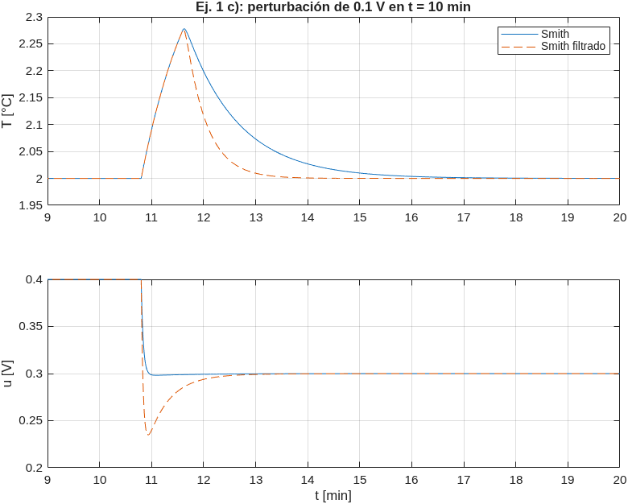

Ante 0.1 V en $t=10$ min: el pico es el mismo (0.277 °C, porque durante el retardo nadie puede hacer nada), pero la temperatura se recupera en **3.2 min** en vez de 5.6 min, sin la "cola" lenta de constante de tiempo 1 min. El precio es una acción de control más brusca.

---

# Ejercicio 2: respuesta inversa con válvula

$$\text{dist}\to(+)\leftarrow\text{man},\qquad G_v=\frac{2}{0.5s+1},\qquad h=\left(\frac{2}{3s+1}-\frac{1}{s+1}\right)G_v\,(\text{man}+\text{dist})$$

$$G_p=\frac{2}{3s+1}-\frac{1}{s+1}=\frac{-s+1}{(3s+1)(s+1)}\qquad(\text{cero en }s=+1)$$

Es el mismo ejemplo de la Conf. 6 ($K_1=2,\ \tau_1=3,\ K_2=1,\ \tau_2=1$), ahora con válvula.

## a) PI por ZN

Sobre $G=G_vG_p$: $K_u=1.615$, $T_u=6.83$ s ⇒ $\boxed{K_c=0.734,\ T_i=5.69\ \text{s}}$.

## b) Compensador

Igual que en clase, pero el compensador recibe la salida del controlador y por eso **tiene que incluir la válvula**:

$$K=\frac{K_1\tau_2-K_2\tau_1}{\tau_2-\tau_1}=\frac{2\cdot1-1\cdot3}{1-3}=0.5$$

$$G_{comp}=K\,G_v\left(\frac{1}{s+1}-\frac{1}{3s+1}\right)=\boxed{\frac{2s}{(0.5s+1)(3s+1)(s+1)}}\qquad y^*=h+G_{comp}\,u$$

**FT que enfrenta el controlador:**

$$\frac{Y^*}{U}=G_vG_p+G_{comp}=\frac{2}{0.5s+1}\cdot\frac{(-s+1)+s}{(3s+1)(s+1)}=\boxed{\frac{2}{(0.5s+1)(3s+1)(s+1)}}$$

Sin cero positivo, y con ganancia estática 2 (la de la planta): el compensador vale 0 en $s=0$.

## c) Módulo óptimo sobre la planta compensada

$T_u=0.5$; se compensan 3 y 1:

$$G_c=\frac{(0.5s+1)(3s+1)(s+1)}{2(0.5)s(0.5s+1)\cdot2}=\frac{(3s+1)(s+1)}{2s}=\boxed{2+\frac{0.5}{s}+1.5s}\quad(\textbf{PID})$$

Se implementa con filtro derivativo: `pid(2, 0.5, 1.5, 0.05)`.

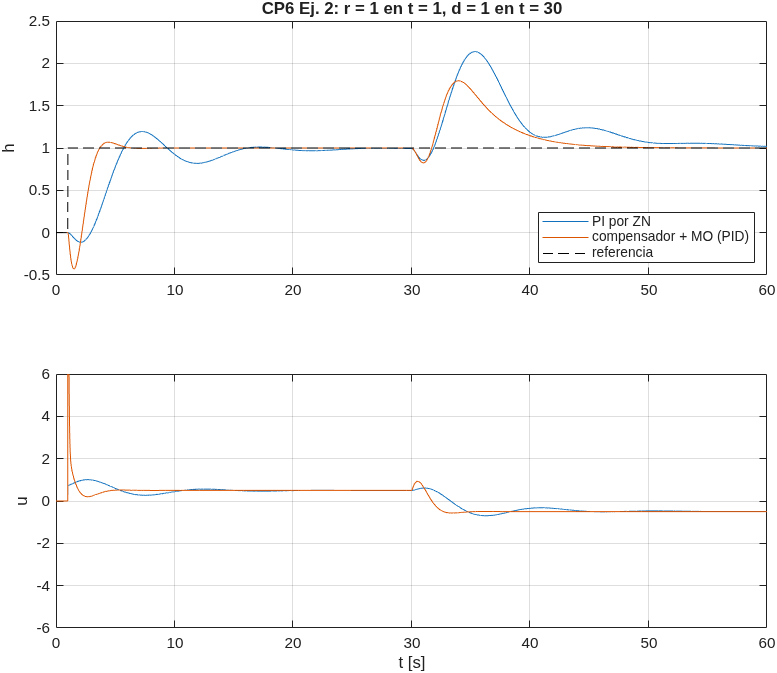

| | $M_p$ | $t_s$ (2 %) | Pico ante $d=1$ |
|---|---|---|---|
| PI por ZN | 19.4 % | 22.8 s | +1.14 |
| Compensador + MO | 6.8 % | **4.6 s** | +0.79 |

- Con el compensador la respuesta es **5 veces más rápida** y con menos sobrepaso.
- La salida real **sigue mostrando la respuesta inversa** (baja a −0.43 al inicio). El compensador la saca del lazo, pero no de la planta: $h/r=(1-s)\cdot\dfrac{1}{0.5s^2+s+1}$. Por ese cero, el sobrepaso es 6.8 % en vez del 4.3 % del MO.
- Ante la perturbación también mejora (pico 0.79 contra 1.14), aunque el compensador no la ve: entra por la válvula, después del punto donde el compensador toma $u$.

## d) Conjunto controlador-compensador

$$u=G_c\,(r-h-G_{comp}u)\ \Rightarrow\ \frac{U}{R-H}=\frac{G_c}{1+G_c\,G_{comp}}\quad\texttt{= feedback(Gc, Gcomp)}$$

Como $G_c\,G_{comp}=\dfrac{(3s+1)(s+1)}{2s}\cdot\dfrac{2s}{(0.5s+1)(3s+1)(s+1)}=\dfrac{1}{0.5s+1}$:

$$G_{eq}=G_c\,\frac{0.5s+1}{0.5s+2}=\frac{(3s+1)(s+1)(s+2)}{2s(s+4)}=\boxed{\frac{1.5\,(s+0.333)(s+1)(s+2)}{s\,(s+4)}}$$

(`minreal` confirma la misma expresión). Es **un solo controlador equivalente**, con integrador y un polo en −4, que se podría cargar directamente en un regulador industrial sin bloque compensador aparte. Tiene 3 ceros y 2 polos (impropio, por la derivada ideal del PID). Con el PID filtrado queda propio: `Geq_f` en `cp6.m`.

---

# Ejercicio 3: planta de fase no mínima con $M_p\le4\%$

$$G_v=\frac{2}{2s+2}=\frac{1}{s+1},\qquad G_p=\frac{-5s+1}{4s+1},\qquad G=\frac{-5s+1}{(s+1)(4s+1)}\quad(\text{cero en }s=+0.2)$$

## a) Diseño

**Por qué no basta un MO directo:** $G_c=\dfrac{1}{2s(s+1)G}=\dfrac{4s+1}{2s(-5s+1)}$ tiene un **polo en $s=+0.2$** (invierte el cero inestable): es inestable. Hay que **compensar primero la respuesta inversa** y después sintonizar.

**Descomposición** en dos capacidades en oposición (división de polinomios):

$$G_p=\frac{-5s+1}{4s+1}=\frac{2.25}{4s+1}-1.25\quad\Rightarrow\quad K_1=2.25,\ \tau_1=4,\ K_2=1.25,\ \tau_2=0$$

(Cumple la condición de cero positivo: $\tau_1/\tau_2=\infty>K_1/K_2=1.8>1$.) Con la fórmula de clase:

$$K=\frac{K_1\tau_2-K_2\tau_1}{\tau_2-\tau_1}=\frac{0-1.25\cdot4}{0-4}=1.25$$

## b) Diagrama de bloques

```
 r ─►(+)──► Gc ──u──┬──► Gv ──► Gp ─────────────┬──► med
      ▲ -           │                           │
      │             └──► Gcomp ── yc ─┐         │
      │                               ▼         │
      └──────────── y* = med + yc ◄──(+)◄───────┘
```

(En Simulink: `cp6_ej3.slx`, un sumador `+ − −` con las entradas $r$, med e $y_c$.)

## c) Cálculo de los bloques

**Compensador** (incluye la válvula, porque recibe $u$):

$$G_{comp}=K\,G_v\left(1-\frac{1}{4s+1}\right)=1.25\cdot\frac{1}{s+1}\cdot\frac{4s}{4s+1}=\boxed{\frac{5s}{(s+1)(4s+1)}}$$

**Planta compensada:**

$$G^*=G+G_{comp}=\frac{-5s+1+5s}{(s+1)(4s+1)}=\boxed{\frac{1}{(s+1)(4s+1)}}$$

**Controlador.** Con MO clásico ($T_u=1$, se compensa 4): $G_c=\dfrac{4s+1}{2s}$, que da $\zeta=0.707$ y 4.3 % en $y^*$. **Pero la variable que importa es med**, no $y^*$:

$$\frac{\text{med}}{r}=\frac{G\,G_c}{1+G_cG^*}=\frac{1-5s}{2s^2+2s+1}\ \Rightarrow\ M_p=\mathbf{10\%}\ \text{(no cumple)}$$

El cero en el SPD sigue en la salida y aumenta el sobrepaso. Se generaliza el MO a $G_cG^*=\dfrac{1}{a\,T_us(T_us+1)}$, que en lazo cerrado da $\dfrac{1}{as^2+as+1}$ con $\zeta=\sqrt a/2$, y se busca el menor $a$ con $M_p\le4\%$ en med:

| $a$ | 2 (MO) | **2.5** | 3 | 4 |
|---|---|---|---|---|
| $M_p$ de med | 10 % | **3.6 %** | 0.8 % | 0 % |
| Subpaso inicial | −1.31 | −1.08 | −0.92 | −0.71 |
| $t_s$ (2 %) | 10.7 | 11.6 | 9.4 | 14.4 |

$$\boxed{a=2.5:\quad G_c=\frac{4s+1}{2.5s}=1.6+\frac{0.4}{s}\quad(\textbf{PI})}$$

## d) Simulación (Simulink)

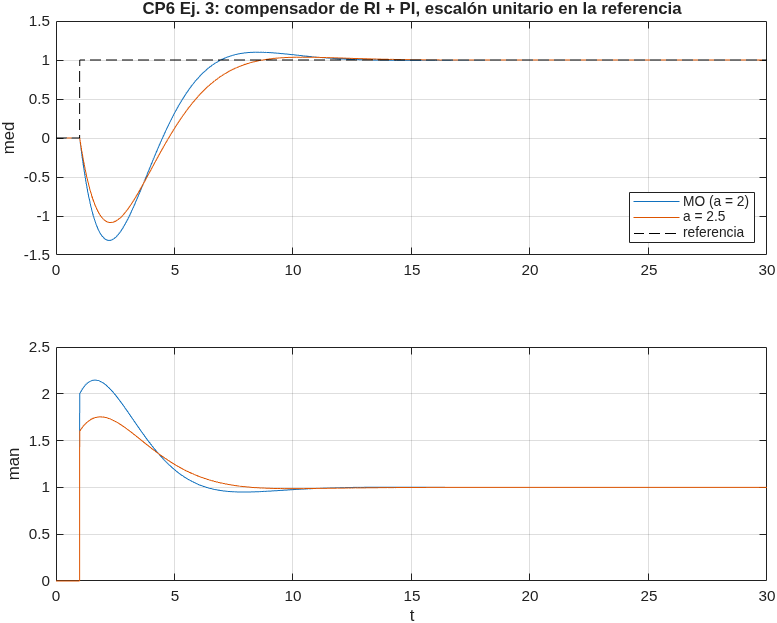
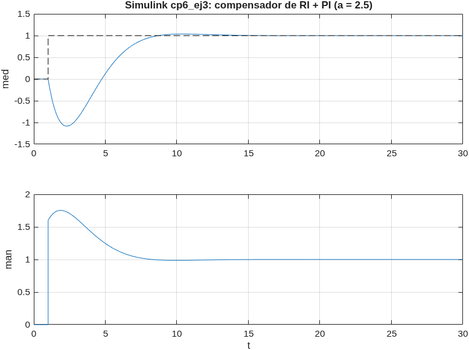

Con $a=2.5$: $M_p=3.6\%$ ✔, $t_s=11.6$, error cero. El **subpaso inicial** es grande (−1.08), inevitable con un cero en el SPD tan lento ($s=0.2$) si se pide una respuesta rápida. Si el proceso no lo tolera, hay que diseñar más lento (mayor $a$).

---

# Ejercicio 4: integrador en oposición

$$G(s)=\frac{k_1}{\tau s+1}-\frac{k_2}{s(\tau s+1)}=\frac{k_1s-k_2}{s\,(\tau s+1)}$$

## a) Condición de fase no mínima

El cero está en $s=\dfrac{k_2}{k_1}$. Es positivo (fase no mínima, respuesta inversa) si

$$\boxed{\frac{k_2}{k_1}>0\ \Leftrightarrow\ k_1\ \text{y}\ k_2\ \text{del mismo signo}}$$

Para $k_1,k_2>0$ siempre ocurre: a frecuencias altas domina $\dfrac{k_1}{\tau s}$ (la salida arranca hacia arriba) y a largo plazo domina $-\dfrac{k_2}{s}$ (termina hacia abajo, como integrador de ganancia negativa).

## b) Compensador

```
 r ─►(+)──► Gc ──u──┬──► [ k1/(τs+1) − k2/(s(τs+1)) ] ──┬──► y
      ▲ -           │                                    │
      │             └──► Gcomp = −k1/(τs+1) ── yc ─┐     │
      │                                            ▼     │
      └───────────────────── y* = y + yc ◄────────(+)◄───┘
```

Se resta a la realimentación la rama que causa la respuesta inversa (el término rápido de signo contrario):

$$\boxed{G_{comp}(s)=-\frac{k_1}{\tau s+1}}$$

Se elige así, y no con la forma $K\left(\frac{1}{\tau s+1}-\frac{1}{s(\tau s+1)}\right)$ de clase, porque esa forma tendría un **integrador** en el compensador, que corre en lazo abierto y lo vuelve internamente inestable ante perturbaciones (ver Conf. 6). $G_{comp}$ es estable. Su ganancia estática ($-k_1$) no causa error: con la planta integradora, en estado estable $u\to0$ y entonces $y^*\to y$.

## c) Planta compensada

$$G^*=G+G_{comp}=\boxed{-\frac{k_2}{s\,(\tau s+1)}}$$

Fase mínima e integradora (tipo 1), con ganancia **negativa**: el controlador debe ser de **acción inversa**.

## d) Controlador

La planta ya tiene integrador, así que basta un **P** para error cero ante escalón en la referencia. Por **módulo óptimo** ($T_u=\tau$, la única constante): $G_cG^*=\dfrac{1}{2\tau s(\tau s+1)}$ (ζ = 0.707, ≈ 4 %):

$$G_c\cdot\left(-k_2\right)=\frac{1}{2\tau}\ \Rightarrow\ \boxed{G_c=-\frac{1}{2\tau k_2}}$$

Salida real: $\dfrac{Y}{R}=\dfrac{GG_c}{1+G_cG^*}=\dfrac{1-\frac{k_1}{k_2}s}{2\tau^2s^2+2\tau s+1}$. Error cero ✔ y sobrepaso cercano al 4 % (el cero aumenta un poco el sobrepaso y produce un pequeño subpaso).

## e) Casos numéricos ($\tau=3$)

| | $k_1=4,\ k_2=2$ | $k_1=2,\ k_2=4$ |
|---|---|---|
| Cero de $G$ | $s=+0.5$ | $s=+2$ |
| $G_{comp}$ | $-\dfrac{4}{3s+1}$ | $-\dfrac{2}{3s+1}$ |
| $G^*$ | $-\dfrac{2}{s(3s+1)}$ | $-\dfrac{4}{s(3s+1)}$ |
| $G_c$ (P) | $-1/12=-0.0833$ | $-1/24=-0.0417$ |
| $M_p$ | 4.6 % | 4.3 % |
| Subpaso | −0.076 | −0.006 |
| $t_s$ (2 %) | 27.1 | 25.8 |

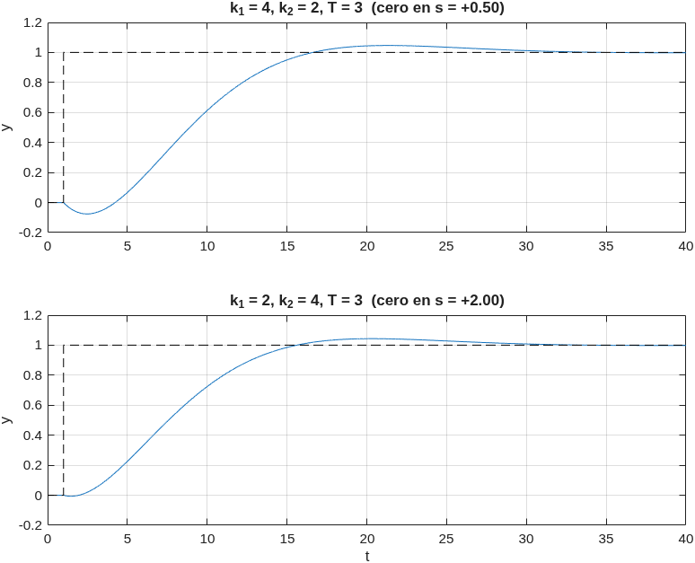

Ambos cumplen "no mucho más de 4 %". El primer caso tiene el cero **más lento** ($s=0.5$, más cerca del origen), así que su respuesta inversa es más visible.

---

# Ejercicio 5: control inferencial de una columna de destilación

$$X_D=\underbrace{\frac{0.9e^{-5s}}{70s+1}}_{G_{d1}}X_F+\underbrace{\frac{1.2e^{-10s}}{30s+1}}_{G_{p1}}R,\qquad T=\underbrace{\frac{0.2e^{-5s}}{60s+1}}_{G_{d2}}X_F+\underbrace{\frac{1}{20s+1}}_{G_{p2}}R$$

$X_D$ no se mide; $T$ (temperatura del tope) sí. $X_F$ es la perturbación (no medida) y $R$ el reflujo (mando).

## a) Esquema inferencial

Despejando $X_F$ de la ecuación de $T$ y reemplazando en la de $X_D$:

$$\hat X_D=\left(G_{p1}-\frac{G_{d1}}{G_{d2}}G_{p2}\right)R+\frac{G_{d1}}{G_{d2}}\,T$$

$$\frac{G_{d1}}{G_{d2}}=\frac{0.9e^{-5s}/(70s+1)}{0.2e^{-5s}/(60s+1)}=\boxed{4.5\,\frac{60s+1}{70s+1}}$$

Los **retardos se cancelan** (los dos son de 5 min) y queda un adelanto-atraso propio: el estimador **es realizable**.

$$\hat X_D=\left(\frac{1.2e^{-10s}}{30s+1}-\frac{4.5(60s+1)}{(70s+1)(20s+1)}\right)R+4.5\frac{60s+1}{70s+1}\,T$$

```
 Xsp ─►(+)──► PID ──R──┬──► [ columna ] ──┬──► XD (no medida)
       ▲ -             │                  └──► T  (medida)
       │               │                         │
       │               └► Gp1 − (Gd1/Gd2)Gp2 ─┐  └► Gd1/Gd2 ─┐
       │                                       ▼              ▼
       └────────────────────────── XD inferida ◄─────(+)◄─────┘
```

Con el modelo exacto, $\hat X_D=X_D$, así que el controlador ve $G_{p1}$.

## b) PID para $X_D$ con $R$

El lazo ve $G_{p1}=\dfrac{1.2e^{-10s}}{30s+1}$: un PORT con $K=1.2$, $\tau=30$, $L=10$, $L/\tau=0.333$ (dentro del rango de las reglas empíricas).

- **ZN lazo abierto** (serie $K'_c=1.2\frac{30}{1.2\cdot10}=3$, $T'_i=20$, $T'_d=5$ → ideal $K_c=3.75$, $T_i=25$, $T_d=4$): da **99 % de sobrepaso** y tarda 198 min en asentarse (`ej5_sintonia.png`). Se descarta.
- **ITAE para cambios en la referencia** (Conf. 2, PID ideal):

$$K_c=\frac{0.965}{1.2}(0.333)^{-0.855}=2.057,\quad T_i=\frac{30}{0.796-0.147(0.333)}=40.2,\quad T_d=0.308\cdot30\,(0.333)^{0.929}=3.33$$

$$\boxed{G_c=2.057\left(1+\frac{1}{40.2s}+3.33s\right)}\qquad(\text{filtro derivativo }N=10)$$

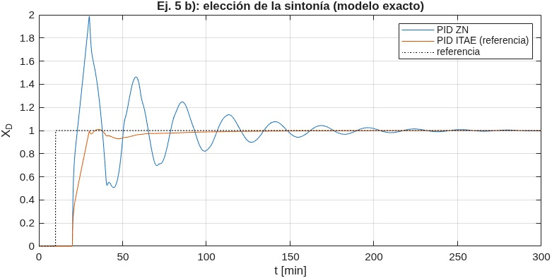

Con ITAE: $M_p=0.9\%$, $t_s=82$ min.

## c) Simulación (Simulink)

`cp6_ej5.slx`: escalón unitario en la referencia en $t=10$ y en $X_F$ en $t=400$ min.

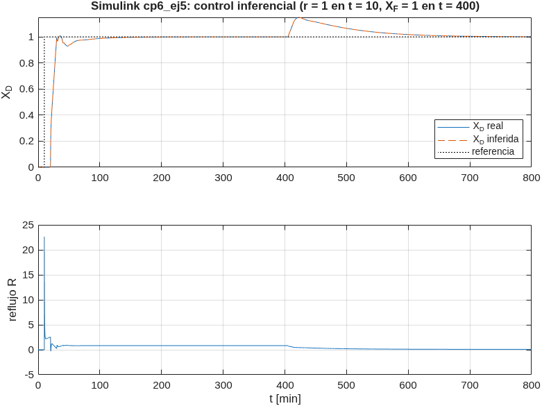

$X_D$ real e inferida coinciden. La perturbación produce un pico de 0.15 que se corrige sin error permanente: el lazo actúa con la estimación (a través de $T$) sin necesidad de medir $X_D$.

## d) Errores en los parámetros de la planta

El estimador queda con el modelo nominal; la planta cambia:

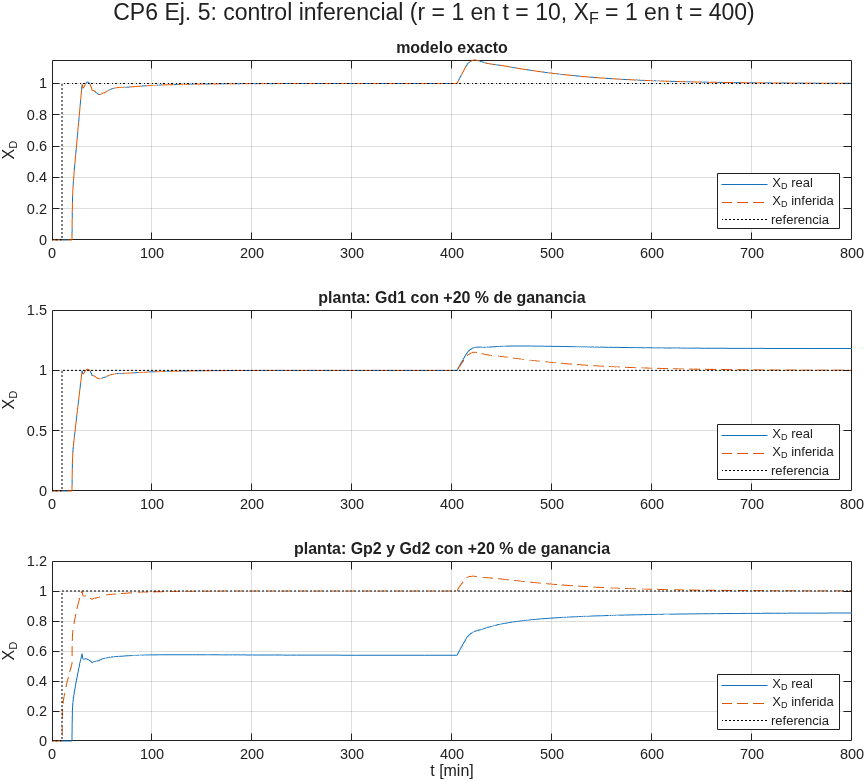

| Caso | $X_D$ real ($t=400$) | $X_D$ real ($t=800$) | $\hat X_D$ ($t=800$) |
|---|---|---|---|
| Modelo exacto | 1.000 | 1.001 | 1.001 |
| $G_{d1}$ +20 % de ganancia | 1.000 | **1.180** | 1.001 |
| $G_{p2}$ y $G_{d2}$ +20 % de ganancia | **0.572** | **0.853** | 1.001 |

- El controlador siempre lleva $\hat X_D$ a la referencia (su integrador lo garantiza). Pero si el modelo está mal, **$\hat X_D\ne X_D$** y la composición real queda con **error permanente**, que el lazo no puede ver.
- Un error en $G_{d1}$ solo afecta cuando hay perturbación (+18 % de error ante $X_F$).
- Un error en la relación $T$–$R$ ($G_{p2}$) contamina la estimación **siempre**, incluso ante la referencia: $X_D$ real queda en 0.57 en vez de 1.
- **Conclusión:** el control inferencial permite controlar una variable que no se mide, pero depende por completo del modelo. En la práctica se corrige la estimación cada cierto tiempo con un análisis de laboratorio (o un analizador lento) que recalibre el sesgo.
