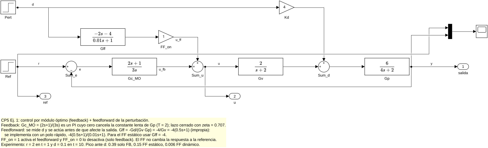
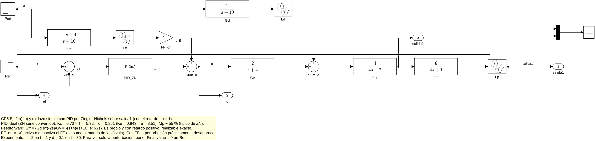
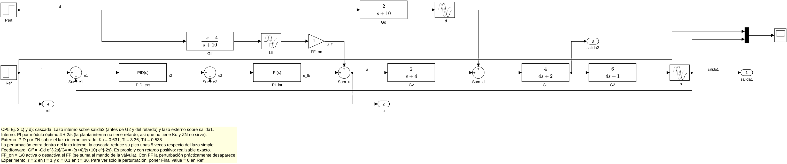
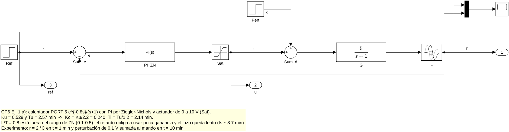
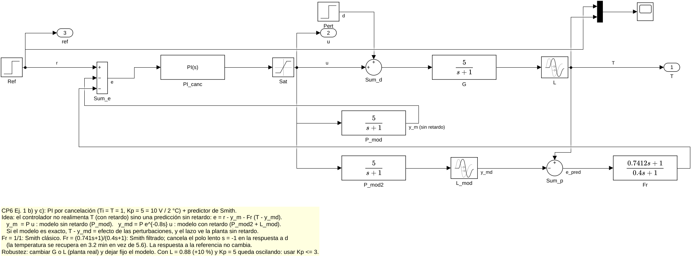
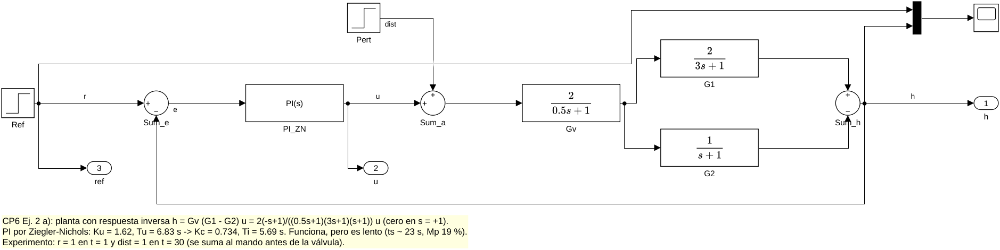
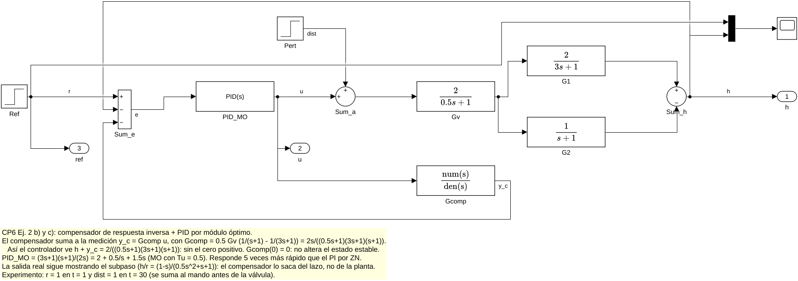
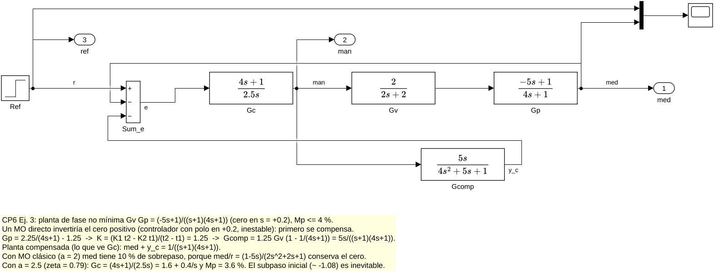
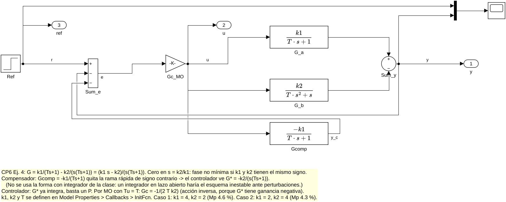
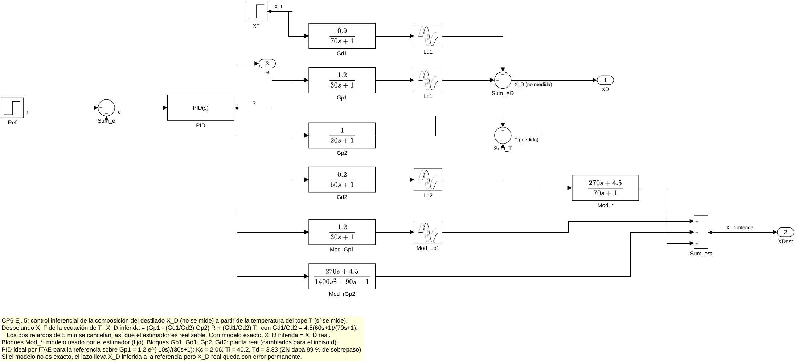

# Diagramas Simulink de los prácticos CP-5 y CP-6: bloques y parámetros

> A diferencia de la guía de CP-1 a CP-4, estos modelos **existen como archivos `.slx`** y **se probaron en Simulink (R2026a)**. Están en `CP5/` y `CP6/`, y las imágenes de abajo se exportaron directamente de ellos.
> Los generan los scripts `CP5/cp5_simulink.m` y `CP6/cp6_simulink.m` (construyen cada modelo bloque por bloque, lo simulan y comparan el resultado con `cp5.m`/`cp6.m`). Si se modifica un `.slx` a mano y se vuelve a correr el script, el modelo se regenera desde cero.
> Las convenciones (rutas de los bloques, bloque PID, cómo leer los diagramas) son las de [`Diagramas_Simulink_CP1-CP4.md`](Diagramas_Simulink_CP1-CP4.md#0-convenciones-y-bloques-comunes).

## Índice
- [Cómo usar los modelos](#cómo-usar-los-modelos)
- [CP-5 Ej. 1: MO + feedforward](#cp-5-ej-1-mo--feedforward--cp5_ej1slx)
- [CP-5 Ej. 2: lazo simple y cascada + feedforward](#cp-5-ej-2-lazo-simple-y-cascada--feedforward)
- [CP-6 Ej. 1: PI por ZN y predictor de Smith](#cp-6-ej-1-pi-por-zn-y-predictor-de-smith)
- [CP-6 Ej. 2: PI por ZN y compensador de respuesta inversa](#cp-6-ej-2-pi-por-zn-y-compensador-de-respuesta-inversa)
- [CP-6 Ej. 3: compensador de RI + PI con Mp ≤ 4 %](#cp-6-ej-3-compensador-de-ri--pi-con-mp--4---cp6_ej3slx)
- [CP-6 Ej. 4: integrador en oposición](#cp-6-ej-4-integrador-en-oposición--cp6_ej4slx)
- [CP-6 Ej. 5: control inferencial](#cp-6-ej-5-control-inferencial--cp6_ej5slx)
- [Resultados de verificación](#resultados-de-verificación)

---

## Cómo usar los modelos

- **Abrir y simular:** doble clic en el `.slx` → *Run*. Cada modelo trae un **Scope** con referencia y salida (vía *Mux*).
- **Nota explicativa:** cada modelo trae, debajo del diagrama, una nota amarilla que explica qué ejercicio resuelve, la idea del esquema, de dónde salen los parámetros, cómo cambiar los casos y qué resultado esperar (es la misma que se ve en las imágenes de abajo).
- **Salidas para graficar:** cada modelo tiene bloques *Out1* (salida, mando, referencia…). Con *Configuration Parameters → Data Import/Export → Output* = `yout` (formato *Dataset*), después de `o = sim('modelo')` se leen como `o.yout{1}.Values` (salida principal), `o.yout{2}.Values` (mando), etc.
- **Sumadores redondos:** el signo de arriba corresponde a la entrada que llega desde arriba (perturbación o feedforward), el de la izquierda a la señal principal y el de abajo a la realimentación. Los **rectangulares** (`+--`) tienen las entradas en orden de arriba hacia abajo.
- **Model Settings:** solver automático (ode45) con *Max step size* fijado (0.002–0.1 según el modelo) para que los retardos y los cambios bruscos se integren bien.
- **Interruptores dentro de los modelos:**

| Modelo | Bloque | Qué cambia |
|---|---|---|
| `cp5_ej1`, `cp5_ej2_*` | Gain **FF_on** | 1 = con feedforward, 0 = sin feedforward |
| `cp6_ej1_smith` | Transfer Fcn **Fr** | `[0.7412 1]/[0.4 1]` = Smith filtrado; `1/1` = Smith clásico |
| `cp6_ej1_smith` | Transport Delay **L** | Retardo de la planta real (para probar errores de modelo; el del predictor es **L_mod**) |
| `cp6_ej4` | *Model Properties → Callbacks → InitFcn* | `k1 = 4; k2 = 2; T = 3;` (caso 1) o `k1 = 2; k2 = 4; T = 3;` (caso 2) |

---

# CP-5 Ej. 1: MO + feedforward — `cp5_ej1.slx`

| Bloque | Tipo | Parámetros |
|---|---|---|
| Ref | Step | Step time 1, Final value **2** |
| Pert | Step | Step time 10, Final value **0.1** |
| Sum_e | Sum | `\|+-` |
| Gc_MO | Transfer Fcn | Num `[2 1]`, Den `[3 0]` → $\frac{2s+1}{3s}$ (PI por MO) |
| Gff | Transfer Fcn | Num `[-2 -4]`, Den `[0.01 1]` → $-4\frac{0.5s+1}{0.01s+1}$ (FF dinámico; para el estático usar Num `-4`, Den `1`) |
| FF_on | Gain | 1 / 0 |
| Sum_u | Sum | `++\|` ($u=u_{fb}+u_{ff}$) |
| Gv | Transfer Fcn | Num `2`, Den `[1 2]` |
| Kd | Gain | 4 |
| Sum_d | Sum | `++\|` |
| Gp | Transfer Fcn | Num `6`, Den `[4 2]` |
| Salidas | Out1 | 1 `salida`, 2 `u`, 3 `ref` |

Simulación: *Stop time* 20, *Max step* 0.01.

---

# CP-5 Ej. 2: lazo simple y cascada + feedforward

## `cp5_ej2_simple.slx`

## `cp5_ej2_cascada.slx`

| Bloque | Tipo | Parámetros |
|---|---|---|
| Ref | Step | Step time 1, Final value **2** |
| Pert | Step | Step time 30, Final value **0.1** |
| PID_ZN (simple) | PID Controller | Form **Ideal**: P = 0.7369, I = 0.1881 (= 1/Ti), D = 0.8506, N = 11.756 (= 10/Td) |
| PID_ext (cascada) | PID Controller | Form **Ideal**: P = 0.6312, I = 0.2975, D = 0.5379, N = 18.59 |
| Sum_e2 (cascada) | Sum | `\|+-` (consigna del externo − salida2) |
| PI_int (cascada) | PID Controller | Controller **PI**, Form Parallel: P = 4, I = 2 (MO del lazo interno) |
| Gff | Transfer Fcn | Num `[-1 -4]`, Den `[1 10]` → $-\frac{s+4}{s+10}$ |
| Lff | Transport Delay | 2 |
| FF_on | Gain | 1 / 0 |
| Gv | Transfer Fcn | Num `2`, Den `[1 4]` |
| Gd | Transfer Fcn | Num `2`, Den `[1 10]` |
| Ld | Transport Delay | 2 |
| G1 | Transfer Fcn | Num `4`, Den `[4 2]` (su salida es **salida2**) |
| G2 | Transfer Fcn | Num `6`, Den `[4 1]` |
| Lp | Transport Delay | 1 (su salida es **salida1**) |
| Salidas | Out1 | 1 `salida1`, 2 `u`, 3 `salida2`, 4 `ref` |

Simulación: *Stop time* 60, *Max step* 0.01. Para el inciso d) (solo perturbación) se pone el *Final value* de **Ref** en 0.

En la cascada, el feedforward se suma a la salida del controlador **interno** (la señal que va a la válvula).

---

# CP-6 Ej. 1: PI por ZN y predictor de Smith

## `cp6_ej1_zn.slx` (inciso a)

## `cp6_ej1_smith.slx` (incisos b y c)

| Bloque | Tipo | Parámetros |
|---|---|---|
| Ref | Step | Step time 1, Final value **2** (°C) |
| Pert | Step | Step time 10, Final value **0.1** (V, sumado al mando) |
| PI_ZN | PID Controller | PI, Parallel: P = 0.2404, I = 0.1124 ($K_c/T_i$) |
| PI_canc | PID Controller | PI, Parallel: P = 5, I = 5 ($K_p=5$, $T_i=1$) |
| Sat | Saturation | Upper 10, Lower 0 (rango del actuador) |
| G, L | Transfer Fcn + Transport Delay | $\frac{5}{s+1}$, retardo 0.8 (planta real) |
| P_mod | Transfer Fcn | $\frac{5}{s+1}$: modelo **sin** retardo → $y_m$ (va a Sum_e) |
| P_mod2, L_mod | Transfer Fcn + Transport Delay | $\frac{5}{s+1}e^{-0.8s}$: modelo **con** retardo → $y_{md}$ |
| Sum_p | Sum | `+-\|`: $e_{pred}=T-y_{md}$ (error de predicción) |
| Fr | Transfer Fcn | `[0.7412 1]/[0.4 1]` (filtrado) o `1/1` (clásico) |
| Sum_e | Sum (rectangular) | `+--`: $e=r-y_m-F_r\,e_{pred}$ |
| Salidas | Out1 | 1 `T`, 2 `u`, 3 `ref` |

Simulación: *Stop time* 20, *Max step* 0.002. El predictor y la planta reciben el mismo mando **después de la saturación**. Para el inciso b) (errores de modelo) se cambian los bloques **G** y **L** y se dejan fijos P_mod, P_mod2 y L_mod.

---

# CP-6 Ej. 2: PI por ZN y compensador de respuesta inversa

## `cp6_ej2_zn.slx` (inciso a)

## `cp6_ej2_comp.slx` (incisos b y c)

| Bloque | Tipo | Parámetros |
|---|---|---|
| Ref | Step | Step time 1, Final value 1 |
| Pert | Step | Step time 30, Final value 1 (`dist`, se suma al mando antes de la válvula) |
| PI_ZN | PID Controller | PI, Parallel: P = 0.7343, I = 0.1290 |
| PID_MO | PID Controller | PID, Parallel: P = 2, I = 0.5, D = 1.5, N = 20 |
| Gv | Transfer Fcn | Num `2`, Den `[0.5 1]` |
| G1 | Transfer Fcn | Num `2`, Den `[3 1]` (entra con **+** a Sum_h) |
| G2 | Transfer Fcn | Num `1`, Den `[1 1]` (entra con **−** a Sum_h) |
| Sum_h | Sum | `+\|-` |
| Gcomp | Transfer Fcn | Num `[2 0]`, Den `[1.5 5 4.5 1]` → $\frac{2s}{(0.5s+1)(3s+1)(s+1)}$ |
| Sum_e | Sum | `\|+-` (ZN) o `+--` (compensado: $r-h-y_c$) |
| Salidas | Out1 | 1 `h`, 2 `u`, 3 `ref` |

Simulación: *Stop time* 60, *Max step* 0.005. El compensador toma la salida del controlador (antes de sumar la perturbación).

---

# CP-6 Ej. 3: compensador de RI + PI con Mp ≤ 4 % — `cp6_ej3.slx`

| Bloque | Tipo | Parámetros |
|---|---|---|
| Ref | Step | Step time 1, Final value 1 |
| Sum_e | Sum (rectangular) | `+--`: $r-\text{med}-y_c$ |
| Gc | Transfer Fcn | Num `[4 1]`, Den `[2.5 0]` → $1.6+\frac{0.4}{s}$ ($a=2.5$) |
| Gv | Transfer Fcn | Num `2`, Den `[2 2]` |
| Gp | Transfer Fcn | Num `[-5 1]`, Den `[4 1]` |
| Gcomp | Transfer Fcn | Num `[5 0]`, Den `[4 5 1]` → $\frac{5s}{(s+1)(4s+1)}$ |
| Salidas | Out1 | 1 `med`, 2 `man`, 3 `ref` |

Simulación: *Stop time* 30, *Max step* 0.01. Para ver el MO clásico, cambiar el denominador de **Gc** a `[2 0]` (da 10 % de sobrepaso).

---

# CP-6 Ej. 4: integrador en oposición — `cp6_ej4.slx`

Los parámetros usan las variables `k1`, `k2` y `T`, que se definen en el callback **InitFcn** del modelo (*Modeling → Model Settings → Model Properties → Callbacks*).

| Bloque | Tipo | Parámetros |
|---|---|---|
| Ref | Step | Step time 1, Final value 1 |
| Sum_e | Sum (rectangular) | `+--`: $r-y-y_c$ |
| Gc_MO | Gain | `-1/(2*T*k2)` (P de acción inversa) |
| G_a | Transfer Fcn | Num `[k1]`, Den `[T 1]` (entra con **+**) |
| G_b | Transfer Fcn | Num `[k2]`, Den `[T 1 0]` (entra con **−**) |
| Sum_y | Sum | `+\|-` |
| Gcomp | Transfer Fcn | Num `-k1`, Den `[T 1]` |
| Salidas | Out1 | 1 `y`, 2 `u`, 3 `ref` |

Simulación: *Stop time* 40, *Max step* 0.01.

---

# CP-6 Ej. 5: control inferencial — `cp6_ej5.slx`

| Bloque | Tipo | Parámetros |
|---|---|---|
| Ref | Step | Step time 10, Final value 1 |
| XF | Step | Step time 400, Final value 1 (perturbación, **no medida**) |
| PID | PID Controller | Form **Ideal** (ITAE referencia): P = 2.0572, I = 0.0249 (= 1/40.16), D = 3.330, N = 3.003 (= 10/Td) |
| Gp1 + Lp1 | Transfer Fcn + Transport Delay | $\frac{1.2}{30s+1}$, 10 |
| Gd1 + Ld1 | Transfer Fcn + Transport Delay | $\frac{0.9}{70s+1}$, 5 |
| Sum_XD | Sum | `++\|` → $X_D$ real (solo para comparar; el lazo **no** la usa) |
| Gp2 | Transfer Fcn | $\frac{1}{20s+1}$ |
| Gd2 + Ld2 | Transfer Fcn + Transport Delay | $\frac{0.2}{60s+1}$, 5 |
| Sum_T | Sum | `+\|+` → $T$ (medida) |
| Mod_Gp1 + Mod_Lp1 | Transfer Fcn + Transport Delay | Modelo de $G_{p1}$: $\frac{1.2}{30s+1}$, 10 |
| Mod_rGp2 | Transfer Fcn | Num `[270 4.5]`, Den `[1400 90 1]` → $\frac{G_{d1}}{G_{d2}}G_{p2}=\frac{4.5(60s+1)}{(70s+1)(20s+1)}$ |
| Mod_r | Transfer Fcn | Num `[270 4.5]`, Den `[70 1]` → $\frac{G_{d1}}{G_{d2}}=\frac{4.5(60s+1)}{70s+1}$ |
| Sum_est | Sum (rectangular) | `+-+` → $\hat X_D$ (va al comparador) |
| Salidas | Out1 | 1 `XD`, 2 `XDest`, 3 `R` |

Simulación: *Stop time* 800, *Max step* 0.1. Para el inciso d) se cambian los bloques de la **planta** (Gp1, Gd1, Gp2, Gd2) y se dejan fijos los del modelo (Mod_*).

---

## Resultados de verificación

Salida de `cp5_simulink.m` y `cp6_simulink.m` (Simulink) comparada con `cp5.m` y `cp6.m` (`lsim`):

| Modelo | Simulink | `lsim` |
|---|---|---|
| CP5 ej. 1: pico ante $d$, sin / con FF dinámico | +0.387 / +0.006 | +0.387 / +0.006 |
| CP5 ej. 2 simple: $M_p$; pico ante $d$ sin / con FF | 55.4 %; +0.0609 / −0.00002 | 55.8 %; +0.0611 / −0.0001 |
| CP5 ej. 2 cascada: $M_p$; pico ante $d$ sin / con FF | 64.7 %; +0.0123 / +0.00001 | 65.1 %; +0.0123 / +0.0001 |
| CP6 ej. 1 ZN: $M_p$; $u_{max}$ | 5.8 %; 0.661 V | 5.9 %; 0.661 V |
| CP6 ej. 1 Smith clásico / filtrado: recuperación ante $d$ | 5.58 / 3.22 min | 5.58 / 3.22 min |
| CP6 ej. 2 ZN / compensado: $M_p$ | 19.4 % / 6.8 % | 19.4 % / 6.8 % |
| CP6 ej. 3: $M_p$; subpaso | 3.61 %; −1.083 | 3.6 %; −1.083 |
| CP6 ej. 4 caso 1 / caso 2: $M_p$ | 4.65 % / 4.35 % | 4.6 % / 4.3 % |
| CP6 ej. 5: $M_p$ | 0.77 % | 0.9 % |

Las diferencias de unas décimas se deben al método de integración (paso variable en Simulink, ZOH con paso fijo en `lsim`).

**Una diferencia que sí importa:** en `cp6_ej1_smith` con el retardo real +10 % (bloque **L** = 0.88), el modelo lineal de `cp6.m` diverge, pero Simulink tiene la **saturación** de 0–10 V, que limita la amplitud: la temperatura queda en una **oscilación sostenida** entre 1.91 y 2.12 °C que no se amortigua. En los dos casos el lazo con $K_p=5$ es inaceptable.
